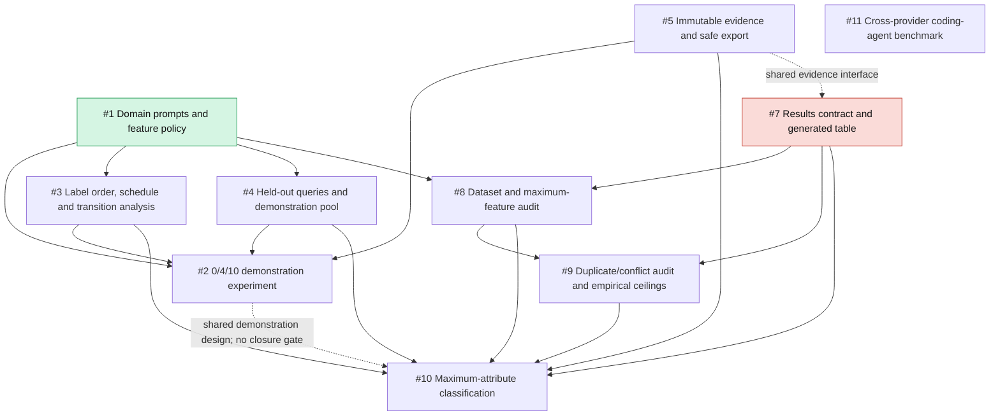

# Ticket dependency map

Arrows point from a prerequisite to the work it enables. GitHub native **blocked by / blocking** links show the same direct prerequisite relationships. This map distinguishes work that can begin from the gates required for final acceptance or model requests. Open does not mean nothing can start. Status is a 2026-11-19 snapshot; GitHub issue state and review evidence are authoritative.

Solid arrows are prerequisite gates, recorded natively on GitHub. Dotted arrows are coordination, not blockers. #11 is intentionally independent. #6 is the merged PR for #1, not a missing ticket.

| Ticket | Prerequisites | Current readiness | Enables |
|---|---|---|---|
| [#1](https://github.com/dsikar/fesa-llm-experiments/issues/1) Domain prompts and feature policy | None | Complete and merged | 2, 3, 4, 8 |
| [#2](https://github.com/dsikar/fesa-llm-experiments/issues/2) 0/4/10 demonstration experiment | #1, #3, #4, #5 | Waiting for execution prerequisites | No closure prerequisite; coordinates the #10 run design |
| [#3](https://github.com/dsikar/fesa-llm-experiments/issues/3) Label order, schedule and transition analysis | #1 | Ready to start | 2, 10 |
| [#4](https://github.com/dsikar/fesa-llm-experiments/issues/4) Held-out queries and demonstration pool | #1 | Ready to start for the baseline | 2, 10 |
| [#5](https://github.com/dsikar/fesa-llm-experiments/issues/5) Immutable evidence and safe export | None | Ready to start; coordinate with #7 | 2, 10 |
| [#7](https://github.com/dsikar/fesa-llm-experiments/issues/7) Results contract and generated table | None | Changes required; open and unmerged | 8, 9, 10 |
| [#8](https://github.com/dsikar/fesa-llm-experiments/issues/8) Dataset and maximum-feature audit | #1, #7 | Inventory can start; final contract output waits for #7 | 9, 10 |
| [#9](https://github.com/dsikar/fesa-llm-experiments/issues/9) Duplicate/conflict audit and empirical ceilings | #7, #8 | Final audit waits for #7/#8 | 10 |
| [#10](https://github.com/dsikar/fesa-llm-experiments/issues/10) Maximum-attribute classification | #3, #4, #5, #7, #8, #9 | Waiting for audit and execution gates | None |
| [#11](https://github.com/dsikar/fesa-llm-experiments/issues/11) Cross-provider coding-agent benchmark | None | Independent; ready to prepare | None |

## What each prerequisite means

- **#1:** None.
- **#2:** Runner/design work can start; no model requests until #3 design/tests, #4 baseline split and #5 evidence capture are ready.
- **#3:** Freeze analysis, schedule and synthetic tests before #2/#10; populate final reports after collection.
- **#4:** Baseline splits can proceed using primary-v1; capacity split amendments also consume #8/#9 before #10.
- **#5:** Build generic capture/resume now; agree schema boundary with #7 and integrate it for capacity runs.
- **#7:** Fix the five review findings and obtain acceptance; coordinate with #5 without a mutual blocking dependency.
- **#8:** Private copies already exist; provenance/schema/leakage inspection can proceed; final validated exports need #7.
- **#9:** Synthetic algorithm development can start; real feature projections require #8 and validated output requires #7.
- **#10:** Coordinate #2 demonstration design; require the #4 capacity split amendment informed by #8/#9, plus a frozen budget.
- **#11:** Reuse #5/#7 conventions where useful; neither blocks benchmark preparation; freeze access/configuration/budget before paid trials.

A prerequisite link means the supporting implementation or design must pass its gate before the dependent activity. For #3 and #5, final reports include collected outcomes, so **do not require their post-run reporting to finish before #2/#10 can collect those outcomes**. Check the prospective design/tests/storage gate before collection; finish report acceptance afterward. Issue closure alone is not evidence that a gate passed, and an unreviewed feature branch is not a usable completed prerequisite.

#4 covers both the original primary-v1 split and later capacity splits. The original #2 experiment does not acquire a new dependency on #8/#9. For #10, its #4 split amendment must use #8's audited projections and #9's collision groups. We therefore record #8/#9 as direct prerequisites of #10, rather than introducing a misleading cycle into #4. Similarly #10 coordinates with #2's demonstration-count design; it does not require #2's final run to have completed as a separate experiment.

## Work available now

1. Repair/review **#7** and develop **#5** in parallel, agreeing their schema/storage boundary.
2. Prepare **#3** and the baseline part of **#4** now; #1 is already complete.
3. Start **#8** inventory/provenance inspection now; finalize its validated output once #7 is accepted. Then complete **#9** and freeze the #4 capacity split amendment.
4. Run **#2** only once its execution gates are met. Run **#10** once its additional feature/collision gates and frozen request budget are met. Decide explicitly whether #2/#10 share a matrix; do not duplicate or silently change request budgets.
5. Prepare **#11** independently; no model-provider benchmark execution has started.

The current bottleneck for the attribute-count path is **#7 acceptance → #8 final audit → #9 collision audit → #10**. Classification also needs **#3/#4/#5** ready, so fixing #7 alone does not authorize a run.

## Maintenance

The machine-readable direct prerequisite list is [configs/issue-dependencies.toml](../configs/issue-dependencies.toml). When changing scope, update this map, that list and native GitHub relationships together. Preserve the distinction between prerequisite gates and coordination; do not add mutual dependencies between #5 and #7 or a circular execution/reporting dependency. Supporting issue bodies link here and describe their own gates.
